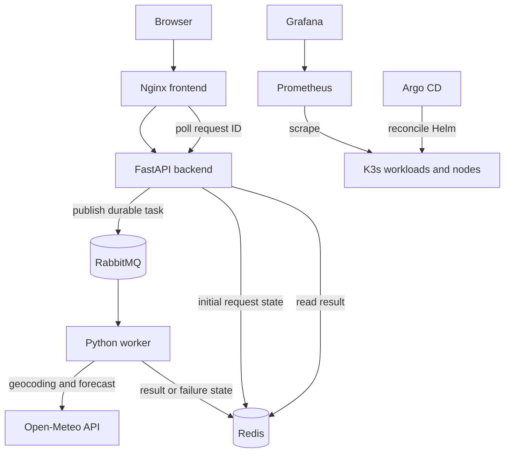

# Raincheck ☁️

**Cloud-native asynchronous weather dashboard | DevOps course capstone**

Raincheck is a distributed weather application deployed on a three-node K3s cluster in AWS. A browser requests weather for a city; a FastAPI service queues the request in RabbitMQ, a Python worker fetches weather from the free [Open-Meteo](https://open-meteo.com/) API, and Redis stores the result for retrieval. A static Nginx frontend displays the response. The project demonstrates infrastructure as code, automated provisioning, container delivery, GitOps, reliability and observability.

> **Project status:** Core system implemented; end-to-end processing, RabbitMQ reliability, CI/CD, Argo CD and monitoring were validated during development. Live availability is not guaranteed when EC2 instances are stopped to control costs.

## Architecture

See [architecture and request flow](docs/architecture.md) and the [editable Excalidraw architecture diagram](docs/Raincheck-Full-Architecture.excalidraw).



## Technology stack

| Layer | Implementation |
| --- | --- |
| Cloud | AWS EC2, VPC, subnet, security groups, encrypted EBS; `eu-north-1` |
| Infrastructure as code | Terraform, S3 remote state with native locking |
| Configuration management | Ansible, three-node K3s cluster |
| Application | Nginx/HTML/JavaScript frontend, Python FastAPI backend, Python worker |
| Messaging and cache | RabbitMQ (main/retry/DLQ), Redis with expiring results |
| Images | Docker, GitHub Container Registry (GHCR) |
| CI/CD | GitHub Actions, Ruff, pytest, pip-audit, Trivy, image SHA tags |
| Kubernetes deployment | Helm chart, Argo CD automated reconciliation |
| Observability | kube-prometheus-stack, Prometheus, Grafana |

## Repository guide

- `app/frontend`, `app/backend`, `app/worker` — application and worker unit tests
- `terraform/` — cloud infrastructure; `terraform/bootstrap/` — remote-state bootstrap
- `ansible/` — K3s installation and node configuration
- `inventory/` and `scripts/update-inventory.sh` — generated Ansible host inventory
- `helm/raincheck/` and `helm/argocd/` — application and Argo CD Helm configuration
- `argocd/` — Raincheck and monitoring Application definitions
- `monitoring/` — Prometheus/Grafana Helm values
- `docs/` — architecture, validation and operations notes

## Request lifecycle

1. A user enters a city in the web dashboard.
2. The backend creates a request ID, writes an initial status to Redis and publishes a persistent message to RabbitMQ.
3. The worker consumes the message and queries Open-Meteo.
4. The worker stores the result in Redis; the browser polls the backend using the request ID.
5. Failed jobs can be retried through a retry queue and eventually routed to a dead-letter queue for inspection.

## CI/CD and GitOps

Changes to application code or the workflow trigger GitHub Actions checks and image builds. The pipeline runs worker lint/tests/dependency auditing, builds three container images, scans them with Trivy, and on eligible `main` runs pushes SHA-tagged images to GHCR. It updates image tags in `helm/raincheck/values.yaml`; Argo CD reconciles the declared Kubernetes state. The workflow can also be triggered manually. Documentation-only commits do not trigger the image pipeline automatically.

## Deployment overview

For detailed infrastructure reconstruction, Kubernetes bootstrap, monitoring CRDs and recovery limitations, see the [rebuild and reproducibility runbook](docs/operations/rebuild.md).

**Prerequisites:** AWS credentials with appropriate permissions, AWS CLI, Terraform, Ansible, Python, kubectl, Helm, and SSH access to the EC2 instances. Running this project on AWS incurs charges; do not assume free-tier eligibility.

1. Review the Terraform variables, IAM permissions, region, remote-state bootstrap and security-group access rules. Never commit `.tfvars`, state files or credentials.
2. Initialize and review Terraform: `cd terraform && terraform init && terraform plan`. Apply **only after reviewing** the plan and expected AWS charges.
3. Once instances are running, generate inventory from AWS: `./scripts/update-inventory.sh` (from the repository root). Ensure the intended AWS profile and region are selected.
4. Install or verify K3s using `ansible/playbooks/install-k3s.yml` with the generated inventory. Check the playbook and Ansible configuration for the required command and SSH key before running it.
5. Use the SSH tunnel and private kubeconfig generated by Ansible for cluster access; the Kubernetes API is not intended to be exposed publicly.
6. Provision required Kubernetes Secrets securely outside Git, including `raincheck-rabbitmq` in namespace `raincheck` and the monitoring credentials. Follow the operational notes for any manual prerequisites.
7. Install/configure Argo CD, apply `argocd/raincheck-application.yaml` and `argocd/monitoring-application.yaml`, and verify synchronization. Prometheus Operator CRDs require deliberate lifecycle management; the monitoring Application uses `skipCrds`.
8. Verify pods, services, queue processing, Redis results and Prometheus targets. See [validation checklist](docs/validation.md).

**Important:** This is a deployment overview, not a claim of a tested zero-touch rebuild. Avoid running `terraform destroy` or applying an unexpected instance replacement: RabbitMQ's local-path persistent volume resides on Worker 2's disk.

## Access and operations

The frontend and backend Kubernetes Services use `ClusterIP`, not a public load balancer. For a local demo, a port-forward can expose the frontend temporarily:

```bash
kubectl -n raincheck get services
kubectl -n raincheck port-forward svc/raincheck-frontend 8080:80
# Open http://localhost:8080
```

Cluster access requires the existing secure SSH tunnel and kubeconfig. Public IPs can change when EC2 instances are stopped and restarted; refresh the generated inventory afterward. Never publish admin credentials, kubeconfig files, SSH keys, or raw Secret values.

## Reliability and limitations

- RabbitMQ includes main, retry and dead-letter queues; worker unit tests and live queue processing were exercised during development.
- Redis is ephemeral and stores weather results with a TTL; it is not a durable database.
- RabbitMQ's local-path persistent volume is tied to a node; replacing Worker 2 can lose broker data. A production deployment would use resilient storage and backup/recovery procedures.
- `/health` on the backend is a basic liveness endpoint, not a dependency-aware readiness check.
- Argo CD reconciliation is automated; the Raincheck Application intentionally does not enable global pruning. Verify actual sync settings before changing them.
- K3s version upgrades are deferred to future work rather than attempted immediately before submission.

## Monitoring and evidence

Prometheus and Grafana provide cluster/workload monitoring; RabbitMQ exposes metrics for queue visibility. During development, 22/22 Prometheus targets were reported healthy. Screenshots and proof of execution should be collected without exposing credentials or public IPs. Use [validation checklist](docs/validation.md) and add evidence under `docs/screenshots/`.

## Security and cost

Infrastructure uses restricted security groups, IMDSv2 and encrypted EBS. Terraform remote state is held in S3; SSH tunnel access is preferred over exposing Kubernetes port 6443. Secrets are not committed to source control. Three EC2 instances, EBS volumes, public IPv4 addresses and S3 resources may incur charges even when some compute resources are stopped. Check billing and resource state after demonstrations.

## Reference and attribution

Raincheck was developed as an independent course project informed by [SkyWatch](https://github.com/yfreifeld/skywatch) and its [assignment write-up](https://github.com/yfreifeld/skywatch/blob/main/ASSIGNMENT.md). Raincheck differs in its frontend/backend split, Redis-backed asynchronous result retrieval, messaging reliability controls, infrastructure security and CI/CD checks.
