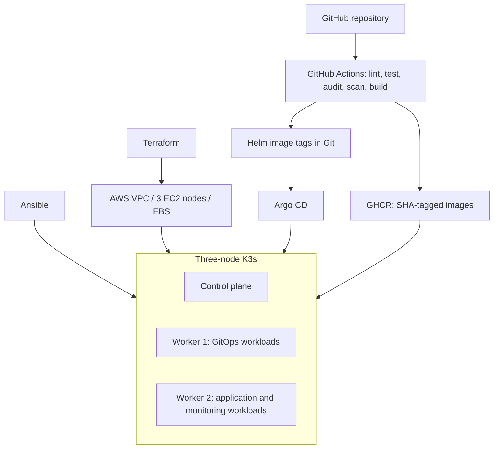
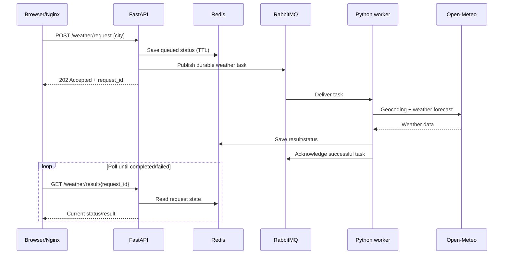

# Raincheck architecture

## Infrastructure and delivery

## Application request and asynchronous response

For failed jobs, the worker uses the RabbitMQ retry and dead-letter queues. Redis is a TTL cache, not durable long-term storage. RabbitMQ's local-path volume is node-bound. Network access to the Kubernetes API is designed to use an SSH tunnel rather than a public API endpoint.
